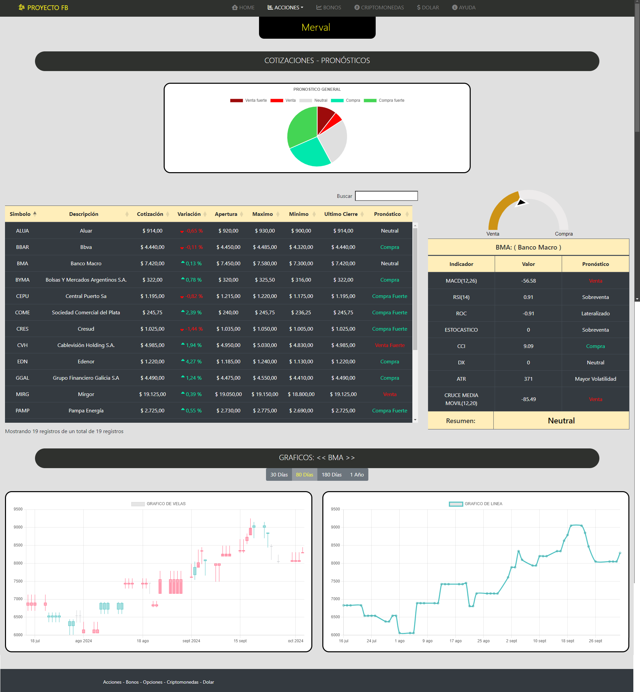
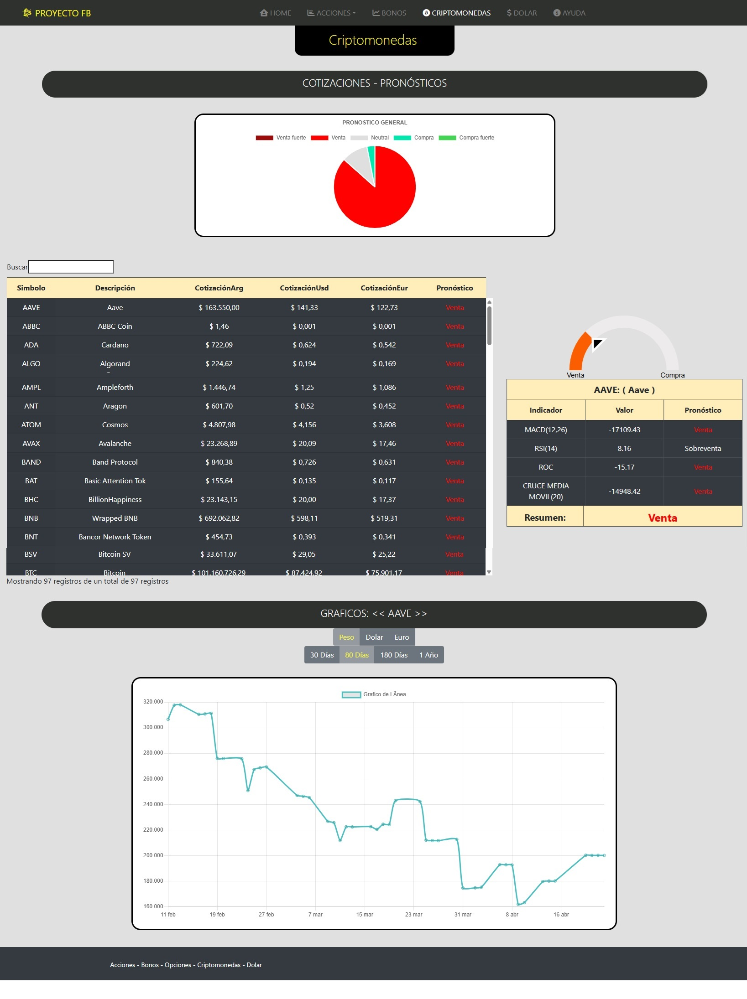

# 📈 Sistema de Análisis Financiero

> Plataforma web inteligente que analiza mercados financieros en tiempo real, genera pronósticos basados en indicadores técnicos y asiste en la toma de decisiones de inversión.

**Tech Stack:**      

---

## 📌 El Problema

Invertir sin análisis técnico es como navegar sin mapa. Los inversores enfrentan:

- 📊 **Información dispersa:** Datos de múltiples fuentes (acciones, bonos, criptos, dólar)
- 🔍 **Análisis manual tedioso:** Calcular indicadores técnicos a mano es lento y propenso a errores
- ⏰ **Decisiones tardías:** Para cuando analizás los números, el mercado ya cambió
- 📈 **Sin pronósticos:** No sabés si es buen momento para comprar o vender
- 🌐 **APIs fragmentadas:** Cada activo viene de un servidor diferente

**La solución:** Un sistema que centraliza todo, analiza automáticamente y genera pronósticos en tiempo real.

---

## 🎯 Qué Hace

### Panel Principal: Dashboard de Inversiones


Visualización centralizada de todos tus activos con cotizaciones actualizadas cada 5 minutos.

### 5 Tipos de Activos Financieros

| Activo | Descripción | Qué Puedes Hacer |
|--------|-------------|------------------|
| **Acciones** | Títulos de empresas (Merval, Merval25, Panel General, Burcap) | Ver cotización, histórico, pronóstico de compra/venta |
| **Bonos** | Valores de renta fija | Analizar rendimiento y volatilidad |
| **CEDEARs** | Acciones extranjeras en bolsa argentina | Diversificación sin abrir cuenta internacional |
| **Dólar** | 4 tipos: Oficial, MEP, CCL, Blue | Seguimiento de cotizaciones y tendencias |
| **Criptomonedas** | Bitcoin, Ethereum, etc. | Análisis de volatilidad y pronósticos |

### Los 8 Indicadores Técnicos (Explicados Sin Jerga)

#### 📈 **Media Móvil (MA)**
Promedio del precio de los últimos X días. Si el precio está arriba de la media móvil → COMPRA. Si está abajo → VENTA.

**Ejemplo:** Precio hoy = $100. Media móvil de 20 días = $98. El precio sube = Señal positiva.

#### 🔄 **MACD (Moving Average Convergence Divergence)**
Compara dos promedios móviles (12 y 26 días) para detectar cambios de tendencia. Cuando se cruzan → Punto de inflexión.

**Ejemplo:** Cuando la línea rápida cruza a la lenta hacia arriba → COMPRA.

#### 💪 **RSI (Relative Strength Index)**
Mide si un activo está "muy comprado" (arriba de 70) o "muy vendido" (abajo de 30).

**Ejemplo:** RSI = 85 (muy comprado) → Próximamente baja. RSI = 15 (muy vendido) → Próximamente sube.

#### 🎯 **Estocástico**
Mide la posición del precio actual respecto a su rango de máximos y mínimos recientes (0-100).

**Ejemplo:** 90 = Precio cerca del máximo = Posible caída. 10 = Precio cerca del mínimo = Posible subida.

#### 🔗 **CCI (Commodity Channel Index)**
Detecta ciclos de precio. Cruces arriba y abajo de bandas = cambios de tendencia.

#### 📊 **DX y ATR (Average True Range)**
Miden volatilidad (cuánto oscila el precio). ATR alto = Mercado nervioso. ATR bajo = Mercado estable.

#### 🚀 **ROC (Rate of Change)**
Velocidad de cambio del precio. Positivo = Aceleración al alza. Negativo = Aceleración a la baja.

#### 🎲 **Pronóstico Final**
El sistema combina los 8 indicadores en un único pronóstico:

```
⭐⭐⭐⭐⭐ COMPRA FUERTE    → Todos los indicadores dicen COMPRA
⭐⭐⭐⭐  COMPRA             → Mayoría indica compra
⭐⭐⭐    NEUTRAL            → Indicadores en desacuerdo
⭐⭐     VENTA              → Mayoría indica venta
⭐      VENTA FUERTE        → Todos los indicadores dicen VENTA
```

---

## 💻 Capturas de Pantalla

### Acciones (Merval, Merval25, etc.)



Visualización de cotizaciones, gráficos históricos y tabla con cambios porcentuales.

### Bonos


Análisis de bonos soberanos y corporativos con rendimiento e indicadores.

### Criptomonedas



Bitcoin, Ethereum y otras criptos con gráficos en tiempo real.

### Dólar (Oficial, MEP, CCL, Blue)


Las 4 cotizaciones del dólar argentino en un solo lugar.

---

## 🏗️ Arquitectura (Cómo Funciona)

### El Flujo de Datos (Paso a Paso)

```
1. EXTRACCIÓN (Python Scripts)
   ├─ APIs externas (Invertir Online, DólarApi, CryptoCompare)
   ├─ Descargan cotizaciones cada 5 minutos
   └─ Resultados en formato JSON

2. ETL (Pentaho Data Integration)
   ├─ Transformación 1: Limpiar datos (eliminar duplicados, validar)
   ├─ Transformación 2: Almacenar histórico del día
   ├─ Transformación 3: Calcular 8 indicadores técnicos
   ├─ Transformación 4: Mapear indicadores a tablas
   └─ Transformación 5: Generar pronóstico final

3. ALMACENAMIENTO (MySQL)
   ├─ Tabla Acciones (precio, fecha, indicadores)
   ├─ Tabla Bonos (similares)
   ├─ Tabla Criptos (similares)
   ├─ Tabla Histórico (registro de cambios)
   └─ Tabla Pronósticos (resultado final)

4. PRESENTACIÓN (Web App Java)
   ├─ Backend: Servlets + JSP
   ├─ Patrón: MVC (Modelo-Vista-Controlador)
   ├─ DAO: Acceso a datos encapsulado
   └─ Frontend: Bootstrap + Chart.js + DataTables

5. VISUALIZACIÓN (Navegador)
   ├─ Gráficos interactivos (Chart.js Financial)
   ├─ Tablas dinámicas con filtros
   └─ Pronósticos en "semáforo" (5 estrellas)
```

### Pentaho ETL (El Motor)

Pentaho orquesta todo el procesamiento de datos. Tiene:

- **8 Transformaciones de Indicadores:** Una para cada indicador técnico
- **5 Transformaciones de Pronósticos:** Una para cada panel de activos
- **3 Jobs principales:**
  - Extracción de datos en tiempo real
  - Procesamiento de histórico del día
  - Generación de pronósticos y cotización actual

#### Ejemplo: Cálculo de MACD


Pentaho compara medias móviles de 12 y 26 días, detecta cruces y genera señales.

---

## 🚀 Quick Start (5 Pasos)

### 1️⃣ Requisitos Previos
```bash
# Verifica que tengas instalado:
Java 8+
MySQL 5.7+
Pentaho 8.0+
Python 3.9+
Tomcat 9+
```

### 2️⃣ Clona el Repositorio
```bash
git clone https://github.com/NBailone/sistema-analisis-financiero.git
cd sistema-analisis-financiero
```

### 3️⃣ Configura la Base de Datos
```bash
# Crea la BD y tablas
mysql -u root -p < db/db.sql

# Las tablas se crean automáticamente:
# - t_acciones (cotizaciones de acciones)
# - t_bonos (cotizaciones de bonos)
# - t_criptos (cotizaciones de criptos)
# - t_dolar (cotizaciones de dólar)
# - t_historico (histórico de cambios)
# - t_indicadores (resultado de indicadores)
# - t_pronosticos (pronósticos finales)
```

### 4️⃣ Configura Pentaho y los Scripts
```bash
# Coloca los archivos ETL en Pentaho
cp -r etl/* /opt/pentaho/

# Instala dependencias Python
pip install -r requirements.txt

# Configura APIs (edita Scripts-data_extraction/config.py):
# - API_KEY_INVERTIR_ONLINE = "tu_clave"
# - API_KEY_CRYPTOCOMPARE = "tu_clave"
```

### 5️⃣ Ejecuta la Aplicación
```bash
# Inicia Pentaho (si no está corriendo)
# Despliega la web app en Tomcat
# Accede a http://localhost:8081/PROYECTO_FB/

# El sistema se actualiza cada 5 minutos automáticamente
```

---

## 📋 Instalación Detallada

### Paso 1: Base de Datos

```bash
# Conecta a MySQL
mysql -u root -p

# Crea la base de datos
CREATE DATABASE analisis_financiero;
USE analisis_financiero;

# Importa el script SQL
SOURCE db/db.sql;

# Verifica las tablas creadas
SHOW TABLES;
```

### Paso 2: Pentaho Data Integration

```bash
# 1. Descarga Pentaho desde: https://www.hitachivantara.com/en-us/products/pentaho-platform.html

# 2. Instala en /opt/pentaho/ (o C:\Program Files\pentaho\ en Windows)

# 3. Copia los procesos ETL
cp -r etl/01_Transformaciones /opt/pentaho/data-integration/
cp -r etl/02_Transformaciones /opt/pentaho/data-integration/
cp -r etl/03_Transformaciones /opt/pentaho/data-integration/
cp -r etl/04_Transformaciones /opt/pentaho/data-integration/
cp -r etl/05_Trabajos /opt/pentaho/data-integration/

# 4. Abre Spoon (GUI de Pentaho) y abre los archivos .ktr para revisar transformaciones

# 5. Agenda los Jobs (.kjb) para ejecutarse cada 5 minutos
```

### Paso 3: Scripts Python

```bash
# Instala dependencias
cd Scripts-data_extraction/
pip install requests mysql-connector-python pandas

# Edita financial_data_extraction.py y configura:
# - Credenciales de base de datos
# - API keys (Invertir Online, CryptoCompare, DólarApi)

# Ejecuta manualmente para probar
python financial_data_extraction.py
python market_data_extraction.py

# Programa ejecución automática (cada 5 minutos):
# En Linux: crontab -e
#   */5 * * * * /usr/bin/python3 /ruta/financial_data_extraction.py
# En Windows: Programador de tareas (Task Scheduler)
```

### Paso 4: Aplicación Web (Java)

```bash
# Compila la aplicación
cd web-app/
ant build

# Despliega en Tomcat
cp dist/PROYECTO_FB.war /var/lib/tomcat/webapps/

# Reinicia Tomcat
systemctl restart tomcat

# Accede a:
# http://localhost:8081/PROYECTO_FB/
```

### Paso 5: Cloudflare Tunnel (Opcional - Para Internet)

```bash
# Instala Cloudflare Tunnel
wget https://github.com/cloudflare/cloudflared/releases/download/2024.1.1/cloudflared-linux-amd64
chmod +x cloudflared-linux-amd64

# Autentica
./cloudflared-linux-amd64 login

# Crea un túnel
./cloudflared-linux-amd64 tunnel create nombre-tunel

# Apunta a tu aplicación local
./cloudflared-linux-amd64 tunnel route dns nombre-tunel tunombre.bd.workers.dev
./cloudflared-linux-amd64 tunnel run nombre-tunel \
  --url http://localhost:8081/PROYECTO_FB/

# Ahora tu app es accesible desde internet de forma segura
```

---

## 🔐 Requisitos y Configuración

### Requisitos del Sistema

| Software | Versión | Propósito |
|----------|---------|-----------|
| **Java** | 8+ | Backend de la web app |
| **MySQL** | 5.7+ | Base de datos |
| **Pentaho** | 8.0+ | ETL y orquestación |
| **Python** | 3.9+ | Extracción de datos desde APIs |
| **Tomcat** | 9+ | Servidor de aplicaciones |
| **Git** | Cualquiera | Control de versiones |

### APIs Externas Necesarias

```
1. Invertir Online
   Endpoint: https://api.invertironline.com/
   Para: Acciones y bonos argentinos
   
2. DólarApi
   Endpoint: https://api.dolares.net/
   Para: Cotizaciones del dólar (oficial, MEP, CCL, Blue)
   
3. CryptoCompare
   Endpoint: https://min-api.cryptocompare.com/
   Para: Criptomonedas
```

### Variables de Configuración

Crea un archivo `config.properties` en la raíz:

```properties
# Base de Datos
db.host=localhost
db.port=3306
db.name=analisis_financiero
db.user=root
db.password=tu_password

# APIs
api.invertir_online=tu_api_key
api.cryptocompare=tu_api_key

# Pentaho
pentaho.path=/opt/pentaho/
pentaho.job.interval=300000  # 5 minutos en milisegundos

# Tomcat
app.port=8081
app.context=PROYECTO_FB
```

---

## 🛠️ Tecnologías Utilizadas

### Backend
- **Java EE:** Servlets, JSP, JNDI
- **Patrón MVC:** Separación de lógica, datos y presentación
- **DAO:** Encapsulación del acceso a datos
- **Connection Pool:** Gestión eficiente de conexiones

### Frontend
- **HTML5, CSS3, JavaScript Vanilla**
- **Bootstrap 4.5:** Diseño responsivo y componentes
- **DataTables:** Tablas dinámicas con filtros, búsqueda, paginación
- **Chart.js:** Gráficos interactivos
- **Chart.js Financial:** Gráficos de velas (candlestick)
- **Luxon:** Manejo de fechas y zonas horarias
- **JustGage.js:** Medidores (gauges) analógicos
- **Font Awesome:** Iconografía

### ETL y Procesamiento
- **Pentaho Data Integration (PDI):** Orquestación de transformaciones
- **Transformaciones (.ktr):** Procesamiento de datos específico por indicador
- **Jobs (.kjb):** Encadenamiento y control de flujo
- **Stored Procedures MySQL:** Lógica complejas en BD

### Base de Datos
- **MySQL / MariaDB 5.7+**
- **Almacenamiento relacional**
- **Índices optimizados** para consultas de históricos
- **Stored Procedures** para cálculos complejos

### Extracción de Datos
- **Python 3.9+:** Scripts de consumo de APIs
- **requests:** Conexiones HTTP a APIs externas
- **mysql-connector-python:** Conexión a MySQL desde Python
- **Pandas:** Procesamiento y validación de datos

### Infraestructura
- **Apache Tomcat 9+:** Servidor de aplicaciones
- **XAMPP:** Stack local (Apache, MySQL, PHP)
- **Cloudflare Tunnel:** Exposición segura a Internet (sin puertos abiertos, TLS)

---

## 📊 Estructura del Proyecto

```
sistema-analisis-financiero/
│
├── 🌐 web-app/                          # Aplicación Web Java
│   ├── src/
│   │   ├── Controladores/               # Servlets (acciones, bonos, etc.)
│   │   ├── modelo/                      # Clases de entidades
│   │   ├── modelo_Dao/                  # Acceso a datos (patrón DAO)
│   │   └── config/                      # Connection Pool
│   ├── WEB-INF/
│   │   ├── paginas/                     # JSP (vistas)
│   │   └── include/                     # Headers, footers, ventanas
│   ├── css/                             # Bootstrap + estilos propios
│   ├── js/                              # Chart.js, DataTables, jQuery
│   └── img/                             # Imágenes de la UI
│
├── 🔧 etl/                              # Procesos Pentaho
│   ├── 01_Transformaciones/             # Extracción y limpieza
│   ├── 02_Transformaciones/             # Cálculo de indicadores
│   ├── 03_Transformaciones/             # Mapeo de indicadores
│   ├── 04_Transformaciones/             # Pronósticos por panel
│   └── 05_Trabajos/                     # Jobs principales (.kjb)
│
├── 🐍 Scripts-data_extraction/          # Extracción de APIs
│   ├── financial_data_extraction.py     # Acciones, bonos, CEDEARs
│   └── market_data_extraction.py        # Dólar, criptos
│
├── 💾 db/                               # Base de datos
│   └── db.sql                           # Script de creación (tablas + stored procedures)
│
├── 📚 docs/                             # Documentación
│   ├── Diagrams/                        # Diagrama de clases, DER
│   └── images/                          # Capturas
│       ├── web_app/                     # Screenshots de la aplicación
│       └── pentaho/                     # Capturas de transformaciones
│
└── 📄 README.md                         # Este archivo
```

---

## 🔄 Cómo Funcionan los Pronósticos

### El Algoritmo Paso a Paso

**Entrada:** Histórico de precios de un activo (últimas 100 cotizaciones)

**Paso 1: Calculo 8 Indicadores**
```
Media Móvil 20 y 40  → Cruce = Señal
MACD                 → Línea rápida vs lenta
RSI                  → ¿Muy comprado o muy vendido?
Estocástico          → Posición en rango (0-100)
CCI                  → Ciclos de precio
DX                   → Fuerza de tendencia
ATR                  → Volatilidad
ROC                  → Velocidad de cambio
```

**Paso 2: Voto Cada Indicador**
```
Si el indicador dice COMPRA  → +1 voto a COMPRA
Si el indicador dice VENTA   → +1 voto a VENTA
Si el indicador es NEUTRAL   → +0 (no influye)
```

**Paso 3: Cuento Votos**
```
Votos COMPRA: 6
Votos VENTA:  2
Votos NEUTRAL: 0

Resultado: 6 votos COMPRA > 2 votos VENTA
Pronóstico: ⭐⭐⭐⭐⭐ COMPRA FUERTE (6/8 indicadores)
```

**Salida:** Pronóstico en estrellas (1-5) + recomendación

### Precisión

Los pronósticos son **herramientas de análisis**, no garantías:
- ✅ Preciso para detectar tendencias de CORTO plazo (1-5 días)
- ⚠️ Menos preciso en mercados altamente volátiles
- ❌ No predice eventos exógenos (noticias, crisis, etc.)

**Usar como:** Complemento a tu análisis fundamental, no como única fuente de decisión.

---

## 🧠 Decisiones de Diseño

### 1. Patrón MVC + DAO
Separación de responsabilidades: Controladores (lógica) → Modelos (datos) → Vistas (presentación). DAO encapsula todo acceso a BD.

**Por qué:** Código modular, testeable, mantenible. Si cambias BD, solo cambias DAO.

### 2. ETL con Pentaho (No Scripts Directos)
Elegí Pentaho sobre Python puro para ETL porque:
- Interfaz visual (fácil mantener sin saber código)
- Orquestación de procesos complejos
- Manejo de errores robusto
- Logging detallado
- Scheduling integrado

**Por qué:** Un analista sin programación puede entender y modificar transformaciones.

### 3. 8 Indicadores + 1 Pronóstico
En lugar de usar un solo indicador (ej: MACD), combiné 8 para:
- Mayor precisión (voto mayoritario)
- Resiliencia (si uno falla, otros lo compensan)
- Visión holística del mercado

**Por qué:** Ningún indicador es perfecto. Juntos forman una visión más confiable.

### 4. Actualización Cada 5 Minutos
No cada minuto porque:
- Evita noise (fluctuaciones sin sentido)
- Reduce carga en APIs externas
- Pronósticos más estables

**Por qué:** Mercado intraday se mueve mucho, pero decisiones inteligentes requieren estabilidad.

### 5. Cloudflare Tunnel (Vs Puertos Abiertos)
Expongo la app via Cloudflare Tunnel en lugar de abrir puertos porque:
- ✅ No abres puertos en tu firewall
- ✅ Todo el tráfico es TLS/encriptado
- ✅ Protección contra DDoS
- ✅ No necesitas IP pública fija

**Por qué:** Seguridad industrial sin complicaciones.

---

## 📈 Casos de Uso

### Inversor Principiante
"Quiero ver si es buen momento para comprar acciones argentinas."
→ Ve Panel General, chequea pronóstico (⭐⭐⭐⭐⭐ = COMPRA), analiza últimos 10 días en gráfico.

### Trader Intraday
"¿Dólar subirá hoy?"
→ Ve Dólar, compara indicadores técnicos, busca cruces de MACD.

### Análista de Renta Fija
"¿Qué bonos están en oversold?"
→ Ve Bonos, filtra por RSI < 30 (muy vendidos), identifica oportunidad.

### Crypto Enthusiast
"¿Bitcoin al alza o caída?"
→ Ve Criptos, chequea ATR (volatilidad), RSI, pronóstico final.

---

## ⚠️ Notas Importantes

### Descargo de Responsabilidad

**Este sistema es una herramienta de análisis, NO es asesoramiento financiero.**

- 📋 Los pronósticos se basan en indicadores técnicos históricos
- 🌍 No predice eventos exógenos (noticias, crisis, política)
- 🎯 Funciona mejor en mercados trending (claros), peor en ranges (laterales)
- 💰 Úsalo como complemento a tu análisis fundamental, NO como única fuente

### Riesgos de Inversión

Invertir siempre implica riesgo de pérdida. No hay ganancia garantizada. Consulta con un asesor financiero antes de invertir.

---

## 👨‍💻 Autor

**Nicolas Bailone**

- 🔗 GitHub: [@NBailone](https://github.com/NBailone)
- 📧 Contacto: [nbailone@gmail.com]

---

## 🎓 Conclusión

Este sistema demuestra mi capacidad para:

- **Integrar múltiples fuentes** de datos en tiempo real
- **Procesar información compleja** con ETL profesional (Pentaho)
- **Generar insights** basados en análisis técnico
- **Crear interfaces intuitivas** para usuarios no-técnicos
- **Escalar soluciones** de prototipo a producción

**Resultado:** Un análisis que antes tomaba horas, ahora se obtiene en segundos. El Pronóstico de cada activo se actualiza cada 5 minutos, permitiendo toma de decisiones ágil y basada en datos.
