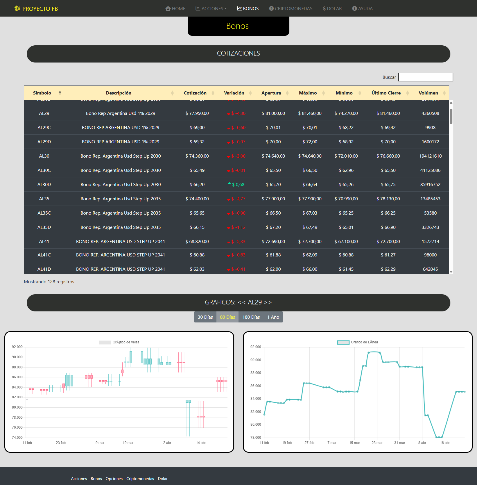
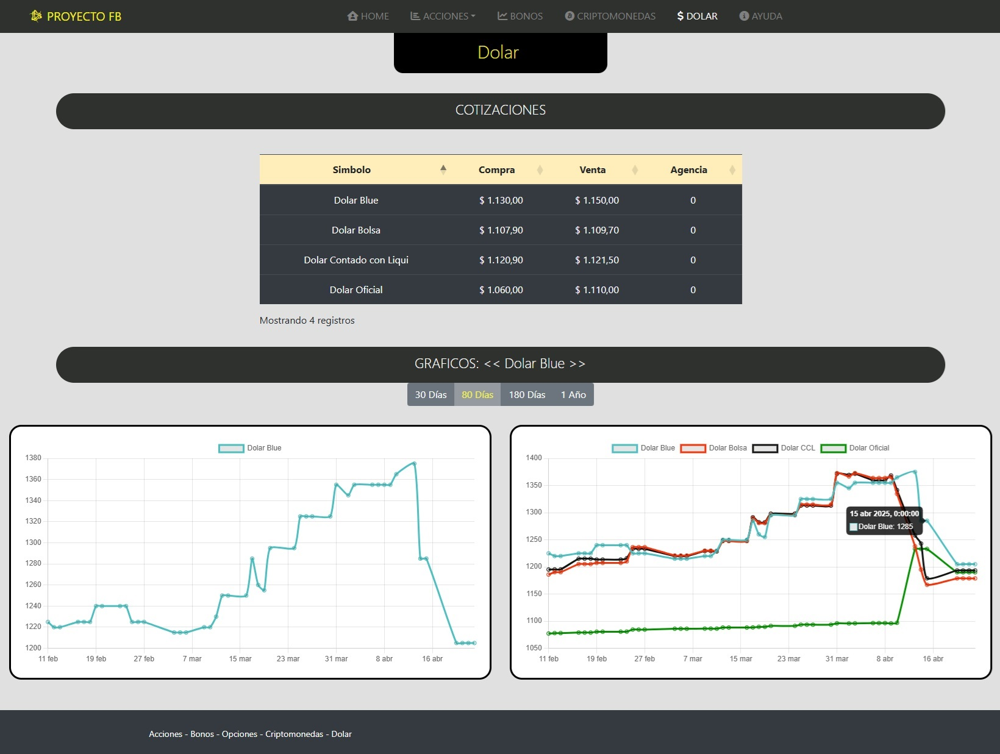

# Sistema de Análisis Financiero

Aplicación web orientada al análisis de mercados financieros, que integra datos en tiempo real, históricos e indicadores técnicos para asistir en la toma de decisiones de inversión.

## 📌 Descripción

El sistema permite visualizar y analizar distintos tipos de activos financieros mediante una interfaz web interactiva. Integra múltiples fuentes de datos, procesa información mediante ETL y genera indicadores y pronósticos para facilitar el análisis financiero.

Está orientado tanto a inversores principiantes como experimentados. Los pronósticos son una herramienta de análisis, no una recomendación de inversión.

---

## 🖼️ Capturas

### Pantalla principal


### Menú de acciones


### Acciones


### Bonos


### Criptomonedas


### Dólar


---

## 🚀 Funcionalidades

- Visualización de cotizaciones en tiempo real
- Consulta de datos históricos de activos financieros
- Cálculo de indicadores técnicos:
  - Media Móvil
  - MACD
  - RSI
  - Estocástico
  - CCI
  - ADX
  - ROC
- Generación de pronósticos por panel de activos
- Visualización de datos mediante gráficos interactivos
- Tablas dinámicas con filtros, ordenamiento y paginación

---

## 📊 Activos soportados

- Acciones (Merval, Merval25, Panel General, Burcap)
- Bonos
- CEDEARs
- Dólar (Oficial, MEP, CCL, Blue)
- Criptomonedas

---

## 🔗 Integración de datos

El sistema obtiene información desde APIs externas:

- Invertir Online → acciones y bonos
- DólarApi → cotizaciones del dólar
- CryptoCompare → criptomonedas

La extracción de datos se realiza mediante scripts en Python que consumen estas APIs y procesan la información en formato JSON.

---

## ⚙️ Procesamiento de datos (ETL)

- Implementado con Pentaho Data Integration
- Transformaciones (`.ktr`) para cada indicador técnico
- Jobs (`.kjb`) para integración de procesos
- Generación de pronósticos por panel de activos
- Manejo de errores y control de ejecución

### 1. Extracción de datos en tiempo real
Un script de Python obtiene las cotizaciones de cada activo y Pentaho las depura y las carga en tablas de MySQL, una por activo.


### 2. Histórico del día
Los datos nuevos se combinan con el histórico ya almacenado, se ordenan, se filtran y se eliminan duplicados antes de guardarlos.


### 3. Cálculo de indicadores técnicos
Cada indicador (MACD, RSI, Media Móvil, ROC, Estocástico, CCI, DX y ATR) tiene su propia transformación. Acá se muestra el MACD, que compara las medias de 12 y 26 días.


### 4. Job de pronósticos y cotización actual
Un job orquesta el proceso: actualiza la descripción de los activos, la cotización actual y ejecuta el pronóstico de cada panel.


### 5. Pronóstico por panel
Cada pronóstico reúne los resultados de los indicadores técnicos y clasifica el activo en Compra fuerte, Compra, Neutral, Venta o Venta fuerte. Ejemplo: Panel General.


<details>
<summary>Ver más transformaciones y pronósticos</summary>


</details>

---

## 🛠️ Tecnologías utilizadas

### Backend
- Java (Servlets, JSP)
- Arquitectura MVC
- DAO (Data Access Object)

### Frontend
- HTML5, CSS3, JavaScript
- Bootstrap
- AJAX
- DataTables

### Visualización
- Chart.js
- Chart.js Financial
- Luxon
- JustGage.js

### Base de datos
- MySQL / MariaDB
- Stored Procedures

### ETL y datos
- Pentaho Data Integration
- Python (extracción de datos desde APIs)

### Infraestructura
- Apache Tomcat
- XAMPP
- Cloudflare Tunnel

---

## 📂 Estructura del Proyecto
```bash
web-app/                 # Aplicación Java Web (Frontend y Backend)
etl/                     # Procesos de Pentaho (Transformaciones y Jobs)
Scripts-data_extraction/ # Scripts Python (Extracción de datos de APIs)
db/                      # Scripts SQL (Base de datos y procedimientos)
docs/                    # Documentación del proyecto
  ├── Diagrams/          # Diagramas de clases y DER
  └── images/            # Imágenes y capturas del sistema
      ├── web_app/       # Capturas de la aplicación
      └── pentaho/       # Capturas de los procesos ETL
```

---

## 🌐 Despliegue
El sistema fue desplegado inicialmente en un entorno local con XAMPP y Apache Tomcat.

Posteriormente se implementó **Cloudflare Tunnel**, permitiendo exponer la aplicación a Internet sin abrir puertos, mejorando la seguridad y accesibilidad mediante conexión cifrada (TLS).

---

## ⚠️ Notas

Para su ejecución completa se requiere:
- Configuración de base de datos
- Procesos ETL con Pentaho
- Configuración de scripts Python
- Acceso a APIs externas
